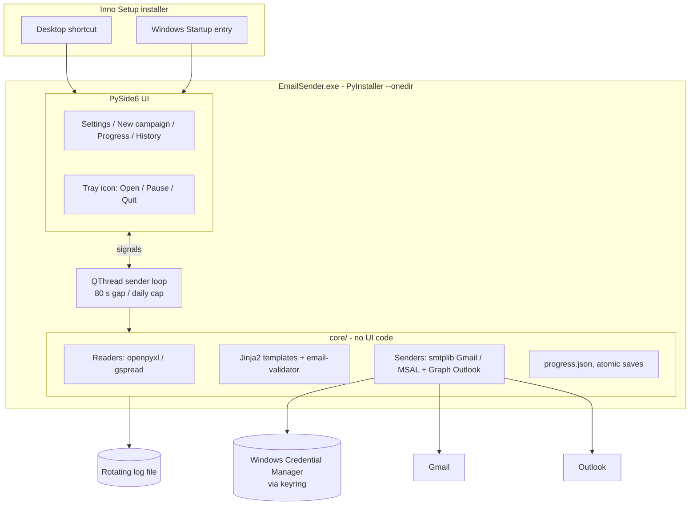
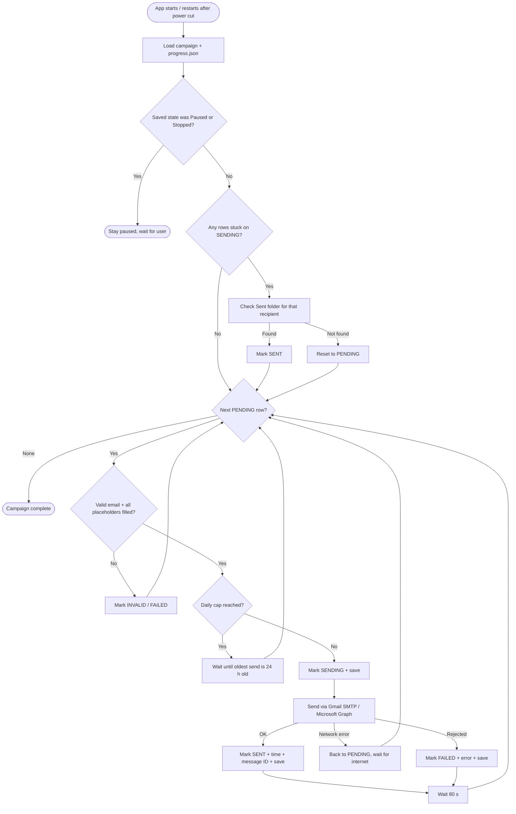
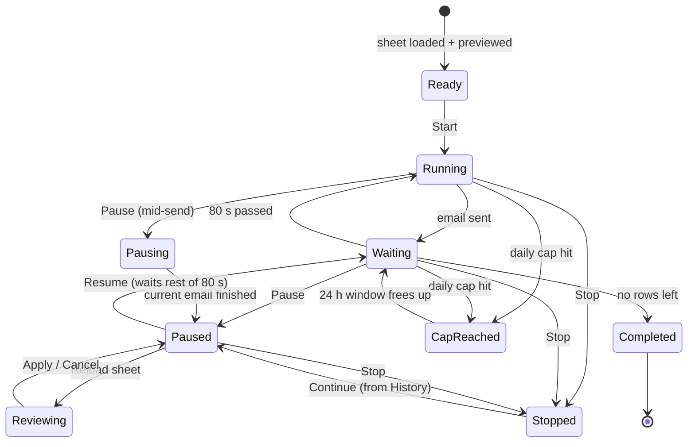

# Email Sender — Design Document

Nov 4, 2026 · @EHM LEAD GEN

## Overview

We will build a free Windows desktop app (Python + PySide6) that each of 5–8 users installs on their own PC. It sends emails one by one from an Excel file or Google Sheet through that user's own Gmail or Outlook, waits 80 seconds between emails, and resumes from the last sent email after a power cut.

**Requirements**

- **Free:** no paid servers, services or licences.
- **Per-PC:** each user runs their own copy; copies are independent.
- **Own mailbox:** each copy sends from its user's Gmail or Outlook account.
- **Sheet-driven:** name, company, email, subject and body come from each row.
- **80-second gap** between emails; one campaign at a time per PC.
- **No code for users:** non-technical users work only through the app window.
- **Pause / Stop / Resume** at any time, e.g. at shift end or while adding data.
- **Failsafe:** after a power cut or crash, continue from the next unsent row with no duplicate sends.
- **No database:** progress is kept in a small file per campaign.

**Known limitation:** while a PC or its internet is off, that user's sending pauses; it resumes automatically when the PC is back on.

## Options considered

A PySide6 desktop app on each PC won: it is free, handles Gmail and Outlook, and is the easiest for non-technical users. The trade-off is that sending pauses while a PC is off.

**Where it runs**

| Option | Free | Sends during power cut | Gmail + Outlook | Verdict |
| --- | --- | --- | --- | --- |
| **App on each PC** | Yes | No, resumes after reboot | Yes | **Chosen** |
| Google Apps Script in the sheet | Yes | Yes | Gmail only, \~100/day on free Gmail | Rejected: no Outlook, low limit |
| n8n on a cloud server | Server costs money | Yes | Yes | Rejected: not free |
| Python + Streamlit on a cloud server | Server costs money | Yes | Yes | Rejected: not free |
| Oracle Cloud free VM | Yes, card needed | Yes | Yes | Rejected: too much setup |

**UI framework** (scored 1–5, weighted)

| Criterion (weight) | PySide6 | NiceGUI + FastAPI | FastAPI + own HTML | Streamlit |
| --- | --- | --- | --- | --- |
| Easy for non-technical users (×3) | 5 | 4 | 4 | 3 |
| Keeps sending when window closed / after reboot (×3) | 4 | 5 | 5 | 2 |
| Packages cleanly to .exe (×2) | 5 | 3 | 4 | 1 |
| Speed to build (×2) | 3 | 5 | 2 | 5 |
| Could move to a server later (×1) | 1 | 5 | 5 | 4 |
| Free and mature (×1) | 5 | 4 | 5 | 5 |
| **Total (of 60)** | **50** | **50** | **45** | **35** |

PySide6 and NiceGUI tie. PySide6 wins the tie because users get a normal Windows app from a shortcut, with no browser or local server involved, and its packaging is mature.

**PySide6 cons and how we handle them**

- More UI code than NiceGUI → keep to four simple screens.
- Closing the window could stop sending → ✕ hides the app to the tray.
- The UI freezes if sending runs in its thread → run the loop in a `QThread`.
- No path to a server version → keep all sending logic in a separate `core/` module.
- Large .exe (about 60–120 MB) → acceptable for 5–8 PCs.
- PyQt6 is GPL → use PySide6 (LGPL), same Qt API.

## Final tech stack

Everything is free and open source.

| Layer | Choice | Alternatives rejected | Why |
| --- | --- | --- | --- |
| Language | Python 3.12 | — | Team already uses it |
| UI | PySide6 + `QSystemTrayIcon` | PyQt6, NiceGUI, Streamlit | Native app, LGPL, tray support |
| Background sending | `QThread` worker + signals | `threading`, `asyncio` | Built into Qt; UI stays responsive |
| Read Excel | openpyxl (via pandas) | xlrd | Reads .xlsx and can export results |
| Read Google Sheets | gspread + one shared service account | Sheets API directly, public CSV link | Users only share the sheet with one address |
| Gmail sending | smtplib + App Password | Gmail API with OAuth | Free, no Google app review, no 7-day re-login |
| Outlook sending | MSAL + Microsoft Graph `sendMail` | Basic-auth SMTP | Basic-auth SMTP is being switched off |
| Passwords and tokens | keyring (Windows Credential Manager) | Plain JSON file | Not stored as readable text |
| Progress / failsafe | `progress.json` per campaign, atomic writes | SQLite, sheet-only status | No database; survives power cuts |
| Email templates | Jinja2 (`{{ name }}`, `{{ company }}`) | `str.format` | Handles missing fields; HTML bodies |
| Address check | email-validator | Regex | Fewer bounces |
| Logs | `logging` with rotating file | — | Troubleshooting on users' PCs |
| Packaging | PyInstaller `--onedir` | Nuitka, `--onefile` | Faster start, fewer antivirus flags |
| Installer + auto-start | Inno Setup | NSIS, MSI | Shortcut, Startup entry, in-place updates |

## Architecture

The UI never sends email itself: it controls a background worker, and all sending logic lives in a `core/` module with no UI code.



**Proposed code layout**

```
email_sender/
  app.py              # entry point: starts Qt app, tray, worker
  ui/                 # PySide6 windows only
    main_window.py
    settings_page.py
    campaign_page.py
    progress_page.py
    history_page.py
  core/               # no Qt imports
    readers.py        # Excel + Google Sheet -> list of rows
    template.py       # Jinja2 rendering, validation
    senders/
      gmail_smtp.py
      outlook_graph.py
    progress.py       # load/save progress.json atomically
    campaign.py       # state machine + send loop
  worker.py           # QThread wrapper around core.campaign
```

**Where data lives** (outside the program folder, so updates keep it):

- `%APPDATA%\EmailSender\settings.json` — sender type, daily cap, display options
- `%APPDATA%\EmailSender\campaigns\<id>\` — copy of the sheet + `progress.json`
- `%APPDATA%\EmailSender\logs\` — rotating logs
- Windows Credential Manager — Gmail App Password, Outlook refresh token

## Input sheet format

One row per email, five required columns in the first sheet tab, headers in row 1. Header names are matched case-insensitively and ignoring spaces.

| Column | Required | Example | Notes |
| --- | --- | --- | --- |
| `name` | Yes | John | Recipient's first name |
| `company` | Yes | Acme Ltd | Recipient's company |
| `email` | Yes | john@acme.com | Must be a valid address; used as the row's identity |
| `subject` | Yes | Quick question, {{ name }} | Can use placeholders |
| `body` | Yes | Hi {{ name }}, I noticed {{ company }}… | Plain text; line breaks kept. Can use placeholders |

```csv
name,company,email,subject,body
John,Acme Ltd,john@acme.com,"Quick question, {{ name }}","Hi {{ name }},\n\nI noticed {{ company }} is hiring..."
Sara,Beta IO,sara@beta.io,Idea for {{ company }},"Hi {{ name }}, ..."
```

**Rules**

- Placeholders use `{{ column_name }}` and may refer to any column, including extra columns users add.
- A row whose placeholder has no value is marked **FAILED** with the reason, not sent with a blank.
- Rows are identified by the **email address** (lower-cased), not the row number, so inserting, deleting or reordering rows is safe.
- The same address twice in one sheet → the first row is sent, later ones are marked **DUPLICATE**.
- **Excel:** the app works on its own copy, so the file can stay open in Excel.
- **Google Sheet:** the user shares the sheet (Viewer) with the app's service account address, shown in Settings, and pastes the link.

**Results export** adds these columns: `status` (SENT / FAILED / INVALID / DUPLICATE / PENDING), `sent_at`, `message_id`, `error`.

## Sending loop and failsafe

Each row's status is saved before and after every send, so a crash at any moment loses at most one in-flight email — and that one is checked against the Sent folder before it is retried.



**Rules**

1. **Atomic saves.** `progress.json` is written to a temp file, flushed to disk, then swapped in with `os.replace`. A power cut mid-write leaves the previous version intact.
2. **SENDING check on restart.** Gmail: search the Sent folder over IMAP (same App Password). Outlook: query Sent Items through Graph. Found → SENT; not found → PENDING.
3. **80-second gap is measured from the last send time saved in the file**, so restarts, pauses and resumes can never send two emails closer than 80 s.
4. **Network errors** (no internet, timeout) do not mark a row FAILED; the worker waits and retries the same row.
5. **Rejections** (bad address, mailbox full, auth error) mark the row FAILED with the error. Three auth errors in a row pause the campaign and ask the user to reconnect their mailbox.
6. **Daily cap** per sender, counted over a rolling 24 hours (the way Google counts); a safety net, since normal shift-length runs stay well below it; default 450 for free Gmail, editable for Workspace and Microsoft 365.
7. **Pause / Stop state is saved too.** After a reboot, a paused campaign stays paused; a running one resumes on its own.

**Pace:** 80 s per email = 45 per hour, up to about 1,080 per day if run nonstop.

**progress.json (sketch)**

```json
{
  "campaign_id": "2026-11-04_dubai-leads",
  "source": "Dubai_Leads_Nov.xlsx",
  "state": "running",
  "last_sent_at": "2026-11-04T14:46:12+05:00",
  "sends_last_24h": ["2026-11-04T14:44:52+05:00", "2026-11-04T14:46:12+05:00"],
  "rows": {
    "john@acme.com": {"status": "SENT", "sent_at": "2026-11-04T14:46:12+05:00", "message_id": "<...>"},
    "bad@x.co": {"status": "FAILED", "error": "550 Mailbox not found"},
    "sara@beta.io": {"status": "PENDING"}
  }
}
```

## GUI

Four screens and a tray icon; one campaign runs at a time, and the user controls it only with Pause, Resume, Stop and Reload. There are no automatic sending hours.

**Screens**

1. **Settings** — choose Gmail or Outlook; *Connect Gmail* (email + App Password, with a Test button) or *Sign in with Microsoft*; daily cap; the service-account address to share Google Sheets with. The 80 s gap is shown but locked.
2. **New campaign** — upload Excel or paste a Google Sheet link; preview the first 10 rows with placeholders filled in; column check (missing columns, invalid emails, duplicates); **Start**.
3. **Progress** — status and countdown to the next email; counts; progress bar; today's sends vs cap; live log; Pause / Stop / Reload buttons.
4. **History** — past campaigns with counts; **Continue** a stopped campaign; **Export results** to Excel.

**Tray icon:** Open, Pause/Resume, Quit. Closing the window with ✕ hides it to the tray and keeps sending; only *Quit* exits, and it asks for confirmation while a campaign is running.

**Controls**

| Button | What happens | Typical use |
| --- | --- | --- |
| Pause | Finishes the email being sent, if any, then holds; state saved | Shift ending, adding or fixing data |
| Resume | Re-reads the sheet, continues from the next unsent row, keeps the 80 s gap | After a break or edit |
| Stop | Ends this run; progress kept; campaign moves to History | Done for now, or the sheet is wrong |
| Reload sheet (paused only) | Shows changes first, e.g. “12 new · 3 edited · 1 removed”, then Apply or Cancel | After adding or editing rows |

**Adding or editing data while paused**

- New rows → PENDING.
- Edited rows not yet sent → the new subject/body/name is used.
- Rows already sent → never re-sent; edits to them are ignored.
- Rows removed from the sheet → dropped if not yet sent.
- Excel: if the file was changed but not saved, the app warns before Resume.

**States**



**Buttons enabled per state**

| State | Start | Pause | Resume | Stop | Reload |
| --- | --- | --- | --- | --- | --- |
| Ready | Yes | — | — | — | Yes |
| Running / Waiting | — | Yes | — | Yes | — |
| Pausing | — | — | — | — | — |
| Paused | — | — | Yes | Yes | Yes |
| Cap reached | — | Yes | — | Yes | — |
| Stopped / Completed | — | — | — | — | — (Continue / Export in History) |

**Progress screen wireframe**

```
+---------------------------------------------------------------+
| Campaign: Dubai_Leads_Nov.xlsx         Sender: ali@company.com |
| Status: RUNNING - next email in 0:47                          |
+---------------------------------------------------------------+
|  Sent 214   Pending 386   Failed 3   Invalid 5   Duplicate 2   |
|  [##########..................] 35%    Today: 214 / 450 cap    |
+---------------------------------------------------------------+
|  [ Pause ]  [ Stop ]  [ Reload sheet ] (only when paused)      |
+---------------------------------------------------------------+
| 14:46:12  SENT     john@acme.com     "Quick question, John"    |
| 14:44:52  SENT     sara@beta.io      "Idea for Beta IO"        |
| 14:43:31  FAILED   bad@x.co          550 Mailbox not found     |
| ...                                        [ Export results ]  |
+---------------------------------------------------------------+
```

## Mailbox setup

Gmail users paste an App Password once; Outlook users sign in with Microsoft once. Neither needs any code.

**Gmail (free Gmail or Google Workspace)**

1. Turn on 2-Step Verification for the Google account.
2. Create an App Password at [myaccount.google.com/apppasswords](https://myaccount.google.com/apppasswords) and copy the 16-character code.
3. In the app: Settings → Connect Gmail → enter email + App Password → Test.
4. The app sends through `smtp.gmail.com:587` (STARTTLS) and checks the Sent folder through `imap.gmail.com:993`.

Workspace admins can block App Passwords; if the option is missing, the admin must allow it.

**Outlook (Outlook.com or Microsoft 365)** — one-time setup by us:

1. Register one free app in Microsoft Entra ID (“Accounts in any organizational directory and personal Microsoft accounts”, public client).
2. Add delegated permissions `Mail.Send`, `Mail.Read` (for the Sent Items check) and `offline_access`.
3. Put the app's client ID in the build.

Then each user: Settings → Sign in with Microsoft → log in in the browser once. MSAL keeps the login renewed and stores it in Credential Manager. Some Microsoft 365 organisations require an admin to approve the app the first time.

**Daily sending limits** (approximate; check against current provider pages before go-live)

| Account type | Approx. limit per day | Hit at 80 s pace after |
| --- | --- | --- |
| Free Gmail | \~500 recipients | \~11 hours |
| Google Workspace | \~2,000 recipients | Not reached (max \~1,080/day) |
| Outlook.com | \~300 recipients | \~6.7 hours |
| Microsoft 365 | \~10,000 recipients | Not reached |

The app's daily cap should be set a little below the account's limit, e.g. 450 for free Gmail.

## Packaging, install and auto-start

Users get one `EmailSender-Setup.exe`; running it installs the app, adds a desktop shortcut and starts the app automatically at every Windows login.

1. **Build:** `pyinstaller --onedir --windowed --name EmailSender app.py` (plus an icon). `--onedir` starts faster and is flagged by antivirus less often than `--onefile`.
2. **Installer:** an Inno Setup script wraps the build folder, creates the desktop and Start-menu shortcuts, and adds a Startup entry that launches the app minimised to the tray.
3. **After a power cut:** PC boots → user logs in → app starts in the tray → reads `progress.json` → resumes if it was running, stays paused if it was paused. If PCs have a Windows password, either enable auto sign-in or accept that sending waits until someone logs in.
4. **Updates:** we release a new installer; running it over the old version keeps all settings, logins and campaigns (they live in `%APPDATA%\EmailSender`).
5. **Only one copy runs:** opening the shortcut again brings the existing window forward instead of starting a second sender.
6. **Antivirus:** if Windows Defender flags the unsigned build, add a folder exclusion for the install folder. Code signing removes this but costs money, so it is out of scope.

**Practical tip:** with load-shedding, a small UPS on the PC and router, or a laptop on battery, keeps sending through most outages.

## Scope, risks and next steps

**Out of scope for v1**

- Do-not-send / suppression list checking (can be added later in `core/` without UI changes)
- Automatic sending hours or scheduled start times
- Running more than one campaign at a time per PC
- Attachments, CC/BCC, open or reply tracking
- A central server or shared dashboard

**Risks**

| Risk | Impact | Mitigation |
| --- | --- | --- |
| PC or internet off | Sending pauses | Auto-resume at login; UPS / laptop battery |
| Mailbox flagged for bulk sending | Emails land in spam or account is limited | 80 s gap, daily cap below provider limit, personalised bodies |
| Workspace / M365 admin blocks App Passwords or the Microsoft app | User cannot connect | Ask admin to allow; Test button shows the exact error |
| Microsoft disables basic-auth SMTP | Outlook SMTP would break | Already avoided: Outlook uses Graph with OAuth |
| Antivirus flags the .exe | App blocked on some PCs | `--onedir` build; folder exclusion |
| User edits a sent row expecting a resend | Confusion | Reload preview shows sent rows are locked |

**Next steps**

- [ ] Confirm the sheet columns and the default daily cap
- [ ] Register the Microsoft Entra app and create the Google service account
- [ ] Build `core/`: readers, templates, Gmail and Outlook senders, `progress.json`
- [ ] Build the send loop with the failsafe and test power-cut recovery (kill the process mid-send)
- [ ] Build the four PySide6 screens and the tray icon
- [ ] Package with PyInstaller + Inno Setup and install on one pilot PC
- [ ] Pilot with one Gmail and one Outlook user for a week, then roll out to all 5–8 PCs
